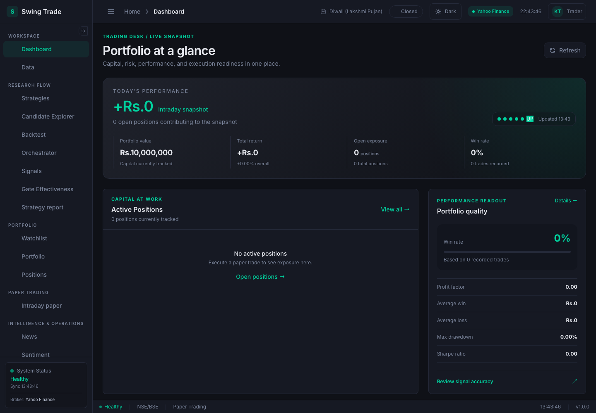
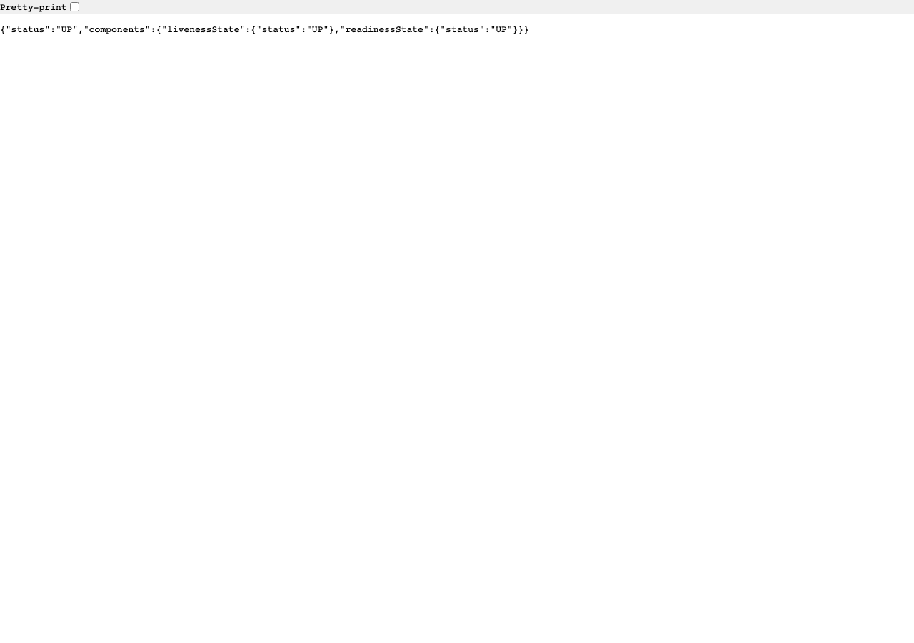
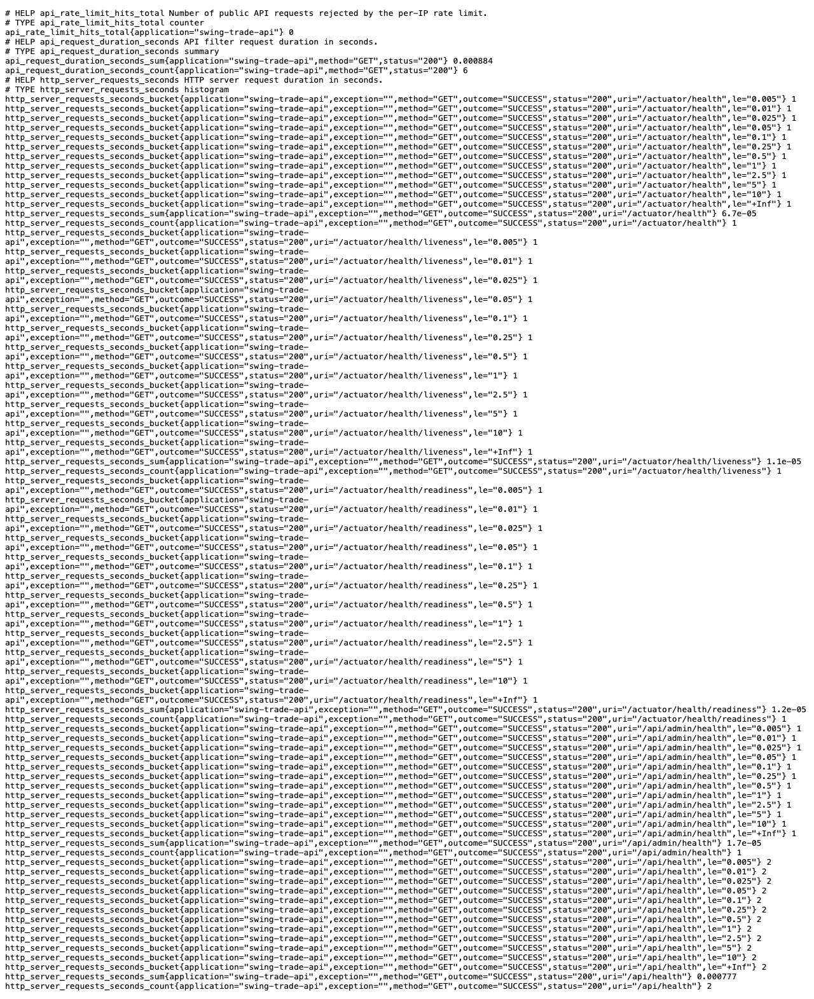
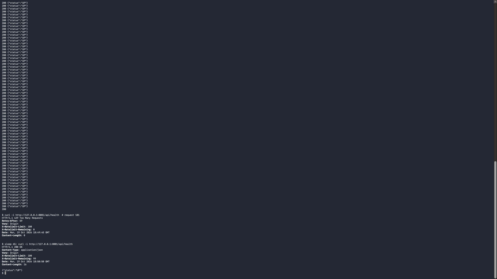

# Phase 1 local-run screenshot evidence

Captured 2026-10-19 on loopback. These artifacts are local-run proof for PR #139; they do not indicate production readiness or authorize stage/Pi deployment.

## Combined dashboard and service run

The dashboard was served on `127.0.0.1:5179`. The existing Java backend was served on `127.0.0.1:8080`, and the no-traffic Go skeleton was served independently on `127.0.0.1:8081`. Java health, Go health, and Go Prometheus requests returned HTTP 200. Browser page errors: none.

The dashboard remained connected to the Java backend. Go was running independently; the dashboard was not routed through or switched to Go. This demonstrates coexistence and separation, not Go feature integration with dashboard endpoints.

## Real-binary Go route checks

The route checks used the real Go binary. Each request returned HTTP 200. The corresponding browser captures are included below.

| Route | Result | Capture |
|---|---:|---|
| `/api/health` | HTTP 200 |  |
| `/api/admin/health` | HTTP 200 |  |
| `/actuator/health` | HTTP 200 |  |
| `/actuator/health/liveness` | HTTP 200 |  |
| `/actuator/health/readiness` | HTTP 200 |  |
| `/actuator/prometheus` | HTTP 200 |  |

## Rate-limit expiry on the real binary

With the public limit set to 100 requests per minute, 101 rapid requests from one loopback client produced 100 HTTP 200 responses followed by HTTP 429. After waiting 65 seconds, the next request returned HTTP 200 with `X-RateLimit-Limit: 100` and `X-RateLimit-Remaining: 99`. The standalone Go binary ran with no database configured.

## Local environment and safety

- Java used a new, empty disposable database on the existing local PostgreSQL instance. Flyway initialized that database; it was dropped after capture.
- Java startup was configured with loopback binding and its startup benchmark backfill, EOD ingestion, and schedulers disabled. The Go service also bound to loopback. No dev, stage, or Pi database or host was accessed in the successful screenshot run.
- An earlier preliminary Java startup attempt ran the default benchmark backfill, issuing Yahoo Finance requests and writing fetched candles only to a throwaway local database. That attempt was not used as evidence, and the database was dropped. The successful screenshot run explicitly disabled the backfill.
- All services and the throwaway database were stopped/dropped after capture.

## Review coverage limitation

The no-mistakes review reported no findings in the final review pass, but reported 45 reviewable files unverified because of a review coverage limit. The remaining paths were lockfiles, module manifests/checksums, and planning/evidence documentation. This coverage limitation was recorded for the captain; it is not evidence that those paths received individual review.

## Boundaries

These screenshots prove only local startup and route responses. They do not show production traffic, Java replacement, API routing to Go, stage deployment, Pi measurements, or stage backup/restore. Those remain out of scope or deferred pending separate authorization.
